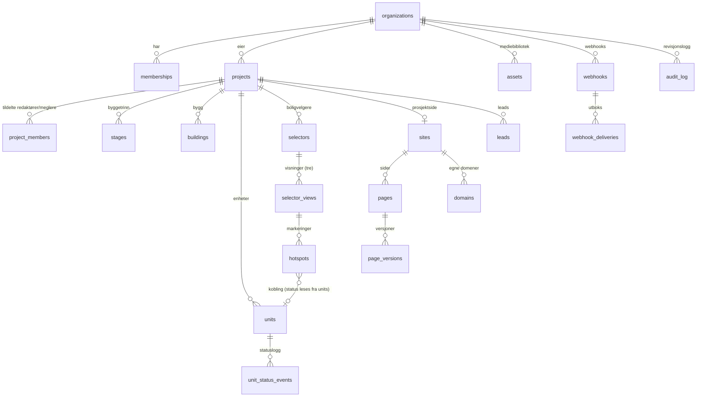

# Arkitektur

Dette dokumentet beskriver mappestruktur, datamodell, tilgangsmodell og de viktigste tekniske valgene. Det hører sammen med migrasjonene i `supabase/migrations/` og faseplanen i [plan.md](plan.md).

`[PRODUKTNAVN]` og `[PLATTFORMDOMENE]` er fortsatt åpne. I koden blir de miljøvariabler (`NEXT_PUBLIC_PRODUCT_NAME`, `NEXT_PUBLIC_PLATFORM_DOMAIN`), så navnet kan byttes uten kodeendringer.

## 1. Plassering i repoet

Repoet inneholder i dag Usett-nettsiden (Next.js med Bootstrap, publisert på Netlify). Plattformen ligger i sin egen mappe, `platform/`, med egen `package.json`, egne avhengigheter og eget Vercel-prosjekt (Root Directory = `platform`). Nettsiden og byggingen av den røres ikke. Mappen kan senere flyttes til et eget repo med full historikk (`git subtree split`).

## 2. Mappestruktur

✔ = levert nå. Resten bygges i fasene i [plan.md](plan.md).

```
platform/
├── README.md                          ✔
├── docs/
│   ├── arkitektur.md                  ✔ dette dokumentet
│   └── plan.md                        ✔ plan per fase, valg og åpne spørsmål
├── supabase/
│   ├── config.toml                    ✔ lokal Supabase (CLI)
│   ├── migrations/                    ✔ datamodell, RLS, funksjoner, lagring, sanntid
│   ├── tests/                         ✔ pgTAP: skjemaregler, isolasjon, roller, status, publisering
│   └── seed.sql                       lokale utviklingsdata (fase 0)
├── package.json, tsconfig.json        TypeScript i strict-modus (fase 0)
├── next.config.ts, eslint.config.mjs
├── vitest.config.ts, playwright.config.ts
├── instrumentation.ts                 Sentry (server)
├── instrumentation-client.ts          Sentry (nettleser)
├── components.json                    shadcn/ui
├── .env.example
├── messages/                          all tekst: nb.json (standard), en.json, sv.json
├── e2e/                               Playwright: akseptkriteriene 1–6
├── scripts/seed-demo.ts               Demo Bolig AS / Fjordparken (fase 5)
└── src/
    ├── proxy.ts                       vertsnavn → admin eller prosjektside, fornyer sesjon
    ├── app/
    │   ├── (auth)/                    logg inn, registrer, glemt passord, invitasjon
    │   ├── (admin)/                   app.[PLATTFORMDOMENE]
    │   │   ├── page.tsx               Oversikt
    │   │   ├── onboarding/            oppstartsveiviser
    │   │   ├── projects/
    │   │   │   ├── new/               veiviser for nytt prosjekt
    │   │   │   └── [projectId]/
    │   │   │       ├── page.tsx       prosjektoversikt med sjekkliste
    │   │   │       ├── units/         regnearktabell, import/eksport, enhetsskjema
    │   │   │       ├── selectors/     boligvelger-editor (Tegn, Koble, Status)
    │   │   │       ├── site/          blokkeditor, sider, tema, versjoner
    │   │   │       ├── leads/
    │   │   │       └── settings/
    │   │   ├── leads/
    │   │   ├── media/                 mediebibliotek
    │   │   └── settings/              organisasjon, brukere, merkevare, domener, abonnement, API
    │   ├── (platform)/platform/       plattformadmin (support)
    │   ├── sites/[site]/              publiserte prosjektsider (omskrevet fra proxy.ts)
    │   │   ├── [[...slug]]/           sider fra blokkeditoren
    │   │   ├── bolig/[unitSlug]/      enhetsside
    │   │   └── personvern/, informasjonskapsler/
    │   ├── embed/selector/[id]/       iframe-reserve for innbygging
    │   └── api/
    │       ├── public/v1/             offentlig lese-API (CORS, bare publiserte data)
    │       ├── leads/                 interesseskjema (Turnstile, honeypot, rate limit)
    │       ├── assets/process/        WebP-varianter med sharp
    │       ├── stripe/webhook/
    │       └── cron/                  webhook-utsending
    ├── components/
    │   ├── ui/                        shadcn/ui
    │   ├── admin/
    │   └── site/blocks/               én komponent per blokktype
    ├── features/                      domenemoduler: Zod-skjema, serverhandlinger, spørringer, komponenter
    │   ├── organizations/  projects/  units/  selector/  site-builder/
    │   └── leads/  media/  billing/  domains/
    ├── lib/
    │   ├── supabase/                  klient for server og nettleser, service-rolle (server-only), genererte typer
    │   ├── auth/                      roller og rettigheter (speiler SQL)
    │   ├── format/                    norsk tallformat: 2 450 000 kr, 68 m²
    │   ├── i18n/
    │   └── cache/                     cache-tagger og revalidering
    └── embed/                         web-komponenten, bygges til public/embed.js
```

## 3. Systemoversikt

| Del | Ansvar |
|---|---|
| Next.js 16 (App Router) på Vercel | Admin, publiserte prosjektsider, enhetssider, innbygging, offentlig API, serverhandlinger, bildebehandling |
| Supabase i EU (Stockholm, `eu-north-1`) | PostgreSQL med RLS, Auth, Storage (bucket `media`), Realtime, pg_cron |
| Stripe Billing | Abonnement. Webhook oppdaterer abonnementsfeltene på `organizations`. |
| Resend | Invitasjoner, varsel om nye leads, kvittering til boligkjøper |
| Cloudflare Turnstile | Spambeskyttelse på interesseskjema |
| Sentry (EU-region) | Feilsporing |

Vertsnavn:

- `app.[PLATTFORMDOMENE]` er admin.
- `{prosjekt}.[PLATTFORMDOMENE]` er gratis underdomene for publiserte prosjektsider.
- Egne domener er publiserte prosjektsider på kundens domene. Kunden peker domenet til Vercel, som utsteder sertifikatet.

`proxy.ts` (Next.js 16 sitt nye navn på middleware) slår opp vertsnavnet og skriver om forespørselen til `app/sites/[site]/…`.

## 4. Datamodell

Alle tabellene fra spesifikasjonen finnes, med feltene som er beskrevet der. Tabeller og felt som er lagt til, står i avsnitt 11.



Regler som håndheves i databasen:

- **Tenant-konsistens.** Rader under et prosjekt bærer både `project_id` og `organization_id`. Alle referanser er sammensatte fremmednøkler, for eksempel `(target_unit_id, project_id, organization_id) → units`. En markering kan dermed ikke peke på en enhet i et annet prosjekt eller en annen organisasjon, uansett hva klienten sender. Nøkkelkolonner (`id`, `organization_id`, `project_id` og forelder) kan ikke endres etter at raden er opprettet.
- **Status lagres bare i `units.status`.** En markering lagrer aldri status eller farge.
- **`unit_number` er unik per prosjekt.** `slug` lages automatisk fra enhetsnummeret: «A-302» blir «a-302».
- **Beløp lagres i hele kroner, arealer i m² med én desimal.** Totalpris og totalpris med fellesgjeld beregnes i én TypeScript-funksjon med enhetstester.
- **Sletting av en enhet fjerner markeringene** som peker på den (ON DELETE CASCADE). Appen teller dem og ber om bekreftelse først. Statushistorikken beholdes med enhetsnummeret.
- **Markeringer** lagres som `[x, y]` mellom 0 og 1. Et rektangel lagres som to hjørner. Ugyldige koordinater avvises.
- **Visningstreet** kan ikke få sykluser, og koblinger mellom visninger må ligge i samme boligvelger.
- **Logger kan ikke endres.** `unit_status_events`, `page_versions` og `audit_log` avviser UPDATE og DELETE for alle roller, også service-rollen. Unntaket er kaskader når et prosjekt, en organisasjon eller en bruker slettes.

## 5. Tilgangsmodell

| | Eier | Admin | Redaktør | Megler | Plattformadmin |
|---|---|---|---|---|---|
| Organisasjon, merkevare, domener, API, webhooks | ✔ | ✔ | – | – | les |
| Abonnement | ✔ ¹ | – | – | – | les |
| Brukere og roller | ✔ | ✔ (ikke eiere) | – | – | les |
| Opprette og slette prosjekter | ✔ | ✔ | – | – | – |
| Innhold, enheter, boligvelger, prosjektside | ✔ | ✔ | tildelte prosjekter | – | les |
| Status og pris på enheter | ✔ | ✔ | tildelte prosjekter | tildelte prosjekter | les |
| Leads | ✔ | ✔ | – | tildelte prosjekter | – |
| Revisjonslogg | ✔ | ✔ | – | – | les |

¹ Abonnementsfeltene endres bare av Stripe-webhooken. Eieren styrer abonnementet gjennom Stripe sin kundeportal.

Slik håndheves det:

- **RLS på alle tabeller.** Policyene bruker `app.project_ids_with_role()` og `app.org_ids_with_role()`. Dette er SECURITY DEFINER-funksjoner som Postgres evaluerer én gang per spørring, ikke per rad.
- **Kolonnerettigheter.** Ingen innloggede brukere kan sette abonnement, publisert innhold, domenebekreftelse, samtykke på leads, logger eller `uploaded_by`/`invited_by` direkte. Slike felt settes av funksjoner eller av service-rollen.
- **Megler** kan bare endre `status`, `price`, `purchase_costs`, `shared_debt` og `monthly_fee`. Dette håndheves av en trigger.
- **Lesemodus.** Når prøveperioden er ute eller abonnementet er avsluttet, slipper alle skrivepolicyer ingenting gjennom. Lesing fungerer som før. Publiserte sider og velgere fortsetter å virke, og leads kan fortsatt slettes (GDPR).
- **Siste eier** kan ikke forlate organisasjonen eller miste eierrollen.
- **Plattformadmin** (tabellen `platform_admins`) får lesetilgang via RLS for support, men ser ikke leads, API-nøkler eller webhooks. Skriving i support-situasjoner skjer gjennom egne serverhandlinger som logges.
- **Grensesnitt og serverhandlinger** sjekker de samme rollene i TypeScript (`src/lib/auth`). Det gir gode feilmeldinger. RLS er den endelige sperren.

## 6. Offentlige data

`anon` har ingen tabellrettigheter. Publiserte sider, boligvelgere, innbygging og det offentlige API-et henter data bare gjennom disse funksjonene (0006):

| Funksjon | Brukes til |
|---|---|
| `get_published_selector(selector_id)` | publisert boligvelger: visninger, markeringer, enheter med live status, statusfarger |
| `get_public_units(project_id)` | Enhetsliste-blokken og API-et |
| `get_public_unit(project_id, slug)` | enhetssiden `/bolig/{slug}` |
| `resolve_site(hostname, subdomain)` | vertsnavn → publisert prosjektside, meny, tema, sider |
| `get_published_page(site_id, slug)` | publisert side |
| `get_public_assets(site_id, asset_ids)` | filer brukt i blokkene |

Funksjonene sikrer at:

- bare publiserte data kommer ut,
- skjulte enheter aldri vises,
- prisen skjules på solgte enheter når `settings.show_price_on_sold` er av (svaret har `price_hidden: true`, så grensesnittet kan vise «Solgt»),
- interne felt aldri kommer ut. Det gjelder notater, logger, leads, `external_id`, `source`, egne felt som ikke er gjort offentlige, og kontaktpersoners bruker-id og lead-innstillinger.

Testene i `005_publisering_og_offentlig_api.test.sql` kontrollerer dette.

## 7. Utkast og publisering

- **Boligvelger.** Editoren skriver direkte i `selector_views` og `hotspots` (utkast). `publish_selector()` lagrer et øyeblikksbilde i `selectors.published_snapshot`. Kjøpere ser bare øyeblikksbildet. Status og enhetsdata hentes alltid live fra `units`. Derfor går statusendringer ut umiddelbart, mens nye former og koblinger venter til neste publisering. `get_selector_preview()` viser utkastet slik kjøpere vil se det.
- **Prosjektside.** `pages.draft_blocks` er utkastet. `publish_site()` kopierer meny, bunntekst, tema, SEO-standarder og samtykkeinnstillinger til `sites.published_config`. Hver side som er endret, kopieres til `published_blocks`. Skjulte blokker beholder innholdet i utkastet, men publiseres ikke. Hver publisert endring blir en ny rad i `page_versions`, som kan gjenopprettes til utkastet.
- **Forhåndsvisningslenker** til prosjektsiden er signerte tokener med utløp (HMAC). De kontrolleres i Next.js (fase 3).

## 8. Sanntid og mellomlager (akseptkriterium 2)

1. Status endres via `set_unit_status()` fra tabellen, enhetsskjemaet eller Status-modus, med valgfritt notat. Direkte oppdateringer logges også.
2. En trigger skriver `unit_status_events` med bruker, tidspunkt, kilde og notat. Deretter legger den inn en linje i revisjonsloggen og en webhook-leveranse, og kringkaster `{unit_id, status}` på den offentlige Realtime-kanalen `project:{id}:units`.
3. Publiserte velgere, enhetslister og enhetssider abonnerer på kanalen og oppdaterer fargene uten ny lasting. Målt lokalt tok det 35 ms fra endring i databasen til en anonym klient mottok meldingen.
4. Serverhandlingen tømmer Next.js-mellomlageret for prosjektet (cache-tagger), slik at neste sidevisning også viser riktig status.
5. Admin (Status-modus og enhetstabellen) lytter på `units` med Postgres Changes. Der gjelder RLS.

## 9. Filer og bilder

- Bucket `media` tar JPG, PNG, WebP og PDF. Bilder kan være inntil 25 MB, dokumenter inntil 50 MB. Stiene har formen `{organization_id}/{asset_id}/…`. Storage-policyene tillater bare opplasting til egen organisasjons mappe.
- Nettleseren laster opp direkte til Storage. Det omgår Vercel sin grense på 4,5 MB for forespørsler. Deretter lager serveren WebP-varianter på 800, 1600 og 2400 px med `sharp` og lagrer originalens størrelse.
- Bucketen er offentlig for lesing, slik at bilder kan leveres raskt fra CDN. Stiene inneholder to tilfeldige uuid-er og kan ikke gjettes.
- SVG-opplasting er ikke tillatt, fordi SVG-filer kan inneholde skript. Demofasaden tegnes som SVG og gjøres om til bilde i seed-skriptet.

## 10. Revisjon, integrasjoner og personvern

- **`audit_log`** registrerer pålogging, statusendringer, publisering og avpublisering, endringer i medlemskap, invitasjoner og prosjekttilgang, opprettelse og sletting av prosjekter, sletting av enheter, API-nøkler, webhooks, domener og sletting av leads. Slettede leads logges uten personopplysninger.
- **Webhooks.** `unit.status_changed` og `lead.created` legges i en utboks (`webhook_deliveries`) i samme transaksjon som hendelsen. En jobb sender dem med HMAC-signatur og nye forsøk med eksponentiell ventetid (fase 4).
- **Forberedt for senere synk.** `unit_status_events` er en egen hendelseslogg, og `external_id` og `source` finnes på enheter, unike per kilde og prosjekt.
- **GDPR.**
  - Alle data ligger i EU.
  - Leads kan slettes og eksporteres.
  - `organizations.lead_retention_days` styrer lagringstiden. En nattlig pg_cron-jobb sletter eldre leads.
  - Samtykke lagres med tidspunkt og tekstversjon.
  - Rate limiting lagrer bare en hash, aldri IP-adressen.

## 11. Tillegg til spesifikasjonen

| Tillegg | Hvorfor |
|---|---|
| `profiles` (uten organization_id) | Navn i logger og brukerlister. `auth.users` kan ikke leses av appen. |
| `platform_admins` (uten organization_id) | Hvem som er plattformadmin |
| `invitations` | Invitasjon på e-post med rolle og prosjekttilgang. Bare en hash av tokenet lagres. |
| `webhook_deliveries` | Utboks for sikker levering av webhooks |
| `rate_limit_buckets` | Rate limiting av interesseskjema, uten egen Redis |
| `organizations`: `subscription_status`, `trial_ends_at`, `current_period_end`, `stripe_subscription_id`, `lead_retention_days`, `locale` | Abonnement, lesemodus og GDPR |
| `organizations.organization_id` (lik `id`) | Så også denne tabellen har organization_id |
| `projects.milestones` som liste | De fire standardmilepælene pluss egne |
| `assets`: `project_id`, `filename`, `variants`, `processing_status`, `uploaded_by` | Bildevarianter og opplastingsflyt |
| `hotspots.target_project_id` | En markering kan peke til et annet prosjekt |
| `pages`: `published_slug`, `published_meta`, `sort_order` | Tittel, adresse og SEO skilles også mellom utkast og publisert |
| `sites.published_config` | Meny, bunntekst og tema publiseres sammen med sidene |
| `domains`: `verification_token`, `status`, `dns_records`, `last_checked_at`, `last_error` | Bekreftelse av egne domener. Bare bekreftede domener må være unike, så ingen kan blokkere den reelle eieren. |
| `leads`: `unit_number`, `consented_at`, `internal_note`, `notified_at` | Riktig enhet også etter sletting, samtykketidspunkt, internt notat og sporing av e-postvarsel |
| `unit_status_events`: `unit_number`, `source` | Historikk etter sletting, og hvor endringen kom fra |

## 12. Supabase sin sikkerhetsrådgiver

`supabase db lint` gir ingen feil. Supabase Security Advisor (splinter) viser disse funnene, som alle er bevisste:

- **`anon_security_definer_function_executable`** og **`authenticated_security_definer_function_executable`.** Gjelder de seks offentlige lesefunksjonene og funksjonene for organisasjon, invitasjon, innlogging og publisering. De er SECURITY DEFINER nettopp for at anon og brukere ikke skal trenge direkte tabelltilgang. Hver funksjon sjekker selv tilgang eller publiseringsstatus, og det er dekket av tester.
- **`rls_enabled_no_policy`** på `rate_limit_buckets`. Tabellen brukes bare av service-rollen.
- **`unused_index`.** Forventet i en tom database.
