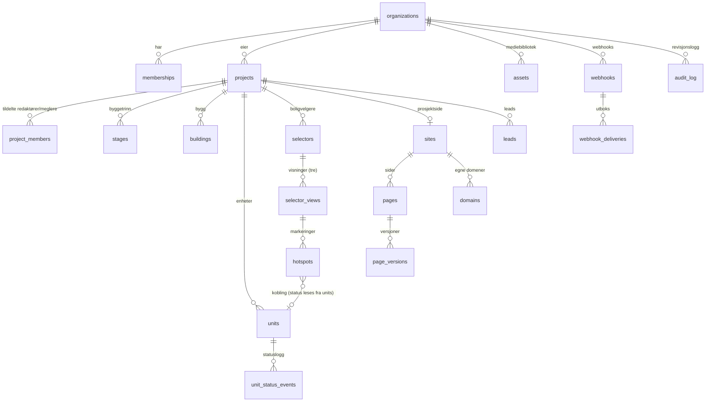

# Arkitektur

Dette dokumentet beskriver mappestruktur, datamodell, tilgangsmodell og de viktigste tekniske valgene. Det hører sammen med migrasjonene i `supabase/migrations/` og faseplanen i [plan.md](plan.md).

`[PRODUKTNAVN]` og `[PLATTFORMDOMENE]` er fortsatt åpne. I koden blir de miljøvariabler (`NEXT_PUBLIC_PRODUCT_NAME`, `NEXT_PUBLIC_PLATFORM_DOMAIN`), så navnet kan byttes uten kodeendringer.

## 1. Plassering i repoet

Repoet inneholder i dag Usett-nettsiden (Next.js med Bootstrap, publisert på Netlify). Plattformen ligger i sin egen mappe, `platform/`, med egen `package.json`, egne avhengigheter og eget Vercel-prosjekt (Root Directory = `platform`). Nettsiden og byggingen av den røres ikke. Mappen kan senere flyttes til et eget repo med full historikk (`git subtree split`).

## 2. Mappestruktur

✔ = bygget. Resten bygges i fasene i [plan.md](plan.md).

```
platform/
├── README.md                          ✔ oppstart, kommandoer, miljøer
├── docs/                              ✔ arkitektur, plan, API (api.md) og drift og personvern (drift.md)
├── supabase/
│   ├── config.toml                    ✔ lokal Supabase (CLI)
│   ├── migrations/                    ✔ datamodell, RLS, funksjoner, lagring, sanntid, fase 0–5
│   ├── tests/                         ✔ pgTAP: skjema, isolasjon, roller, status, publisering, fase 0–5
│   └── templates/                     ✔ norske e-postmaler for Supabase Auth
├── package.json, tsconfig.json        ✔ TypeScript strict
├── next.config.ts                     ✔ Cache Components, sikkerhetshoder, next-intl, Sentry
├── eslint.config.mjs, vitest.config.mts, playwright.config.ts   ✔
├── components.json                    ✔ shadcn/ui
├── vercel.json                        ✔ funksjoner i Stockholm (arn1) og planlagte jobber (cron)
├── .env.example                       ✔
├── messages/                          ✔ all tekst: nb.json (standard), en.json, sv.json
├── e2e/                               ✔ Playwright (fase 0–5): akseptkriterium 2 og 3 i fase2.spec.ts, 5 og 1 i fase3.spec.ts,
│                                      4 i fase4.spec.ts, 6, universell utforming (axe) og personvern i fase5.spec.ts.
│                                      support/ etterligner Stripe og DNS over HTTPS og lager demodata.
├── lighthouserc.yml                   ✔ Lighthouse CI: LCP under 2,5 s på mobil, bilder i riktig størrelse og lat lasting
├── scripts/copy-vendor.mjs            ✔ kopierer MapLibre sin web-worker til public/vendor/ før dev og build
├── scripts/build-embed.mjs            ✔ bygger web-komponenten til public/embed/v1.js før dev og build
├── test/                              ✔ tester på tvers av moduler (oversettelser)
├── scripts/demo.ts                    ✔ demodata: Demo Bolig AS med Fjordparken (npm run demo)
├── scripts/lighthouse.mjs             ✔ Lighthouse CI mot demosiden (npm run lighthouse)
└── src/
    ├── proxy.ts                       ✔ fornyer sesjonen, krever innlogging, husker organisasjon, sender
    │                                  underdomener og egne domener til sites/, og videre til primærdomenet
    ├── instrumentation.ts, instrumentation-client.ts   ✔ Sentry (EU, uten personopplysninger)
    ├── app/
    │   ├── (auth)/                    ✔ login, signup, forgot-password, reset-password, invite/[token]
    │   ├── auth/confirm/              ✔ mål for lenker i e-post fra Supabase Auth
    │   ├── (app)/
    │   │   ├── page.tsx               ✔ sender til sist brukte organisasjon
    │   │   ├── (user)/                ✔ onboarding, account, platform (plattformadmin)
    │   │   └── [org]/                 ✔ admin per organisasjon: app.[PLATTFORMDOMENE]/{org}/…
    │   │       ├── page.tsx           ✔ Oversikt
    │   │       ├── settings/          ✔ organisasjon, brukere, merkevare, domener, abonnement og API
    │   │       ├── projects/          ✔ liste, veiviser, oversikt, innstillinger, enheter, enhetsskjema, CSV-eksport,
    │   │       │                      ✔ boligvelgere og editor (selectors/), prosjektside (site/), leads per prosjekt
    │   │       ├── leads/             ✔ liste med filter, detalj, status og notat, CSV-eksport (export/), innsyn (innsyn/)
    │   │       └── media/             ✔ mediebibliotek
    │   ├── sites/[site]/              ✔ publiserte prosjektsider: sider, bolig/[slug], personvern, informasjonskapsler,
│   │                              sitemap.xml, robots.txt
    │   ├── preview/[token]/           ✔ delt forhåndsvisning av utkastet (signert lenke)
    │   ├── site-preview/[siteId]/     ✔ forhåndsvisningen i editoren (iframe, krever innlogging)
    │   ├── embed/selector/[id]/       ✔ publisert boligvelger, preview/ (utkast for innloggede), bolig/[slug] (enhetsside)
    │   └── api/                       ✔ public/v1 (åpent lese-API), v1 (API med nøkkel), stripe/webhook, cron/
    │                                  (webhooks, domener, varsler) og health (helsesjekk). Leads og bildebehandling
    │                                  er serverhandlinger.
    ├── components/
    │   ├── ui/                        ✔ shadcn/ui
    │   ├── forms/                     ✔ felles skjemahjelpere
    │   └── admin/                     ✔ toppmeny, organisasjonsvelger, brukermeny
    ├── features/                      domenemoduler: Zod-skjema, serverhandlinger, spørringer, komponenter
    │   ├── auth/  organizations/  members/  invitations/  account/   ✔
    │   ├── projects/                  ✔ veiviser, Kartverket, kart, fremdrift, kontakter, byggetrinn og bygg,
    │                                  oversikt med verdi solgt og sjekkliste for oppstarten
    │   ├── units/                     ✔ felt og tolking, prisberegning, tabell, skjema, import/, eksport
    │   ├── media/                     ✔ opplasting, bildevarianter (sharp), bibliotek, filvelger
    │   ├── selector/                  ✔ geometri, angre, filtre, visningstre, editor/, public/, serverhandlinger
    │   ├── site-builder/              ✔ blokker, maler, tema, rik tekst, SEO, editor/, render/, mellomlager
    │   ├── leads/                     ✔ interesseskjema, samtykke, Turnstile, innsending, admin, CSV og innsyn per person
    │   ├── demo/                      ✔ demodata for Fjordparken: leiligheter, fasade i SVG og markeringer
    │   ├── domains/                   ✔ vertsnavn, DNS over HTTPS, Vercel Domains API, sjekk og Innstillinger → Domener
│   ├── billing/                   ✔ Stripe (Checkout, kundeportal, synk fra webhook), Innstillinger → Abonnement
│   ├── launch/                    ✔ lansering med oppstartsavgift: Checkout, registrering av betalingen, siden Lansering
│   ├── integrations/              ✔ API-nøkler, webhooks (utsending, signatur, SSRF-vern), Innstillinger → API
│   └── platform/                  ✔ forlengelse av prøveperioden (plattformadmin)
    ├── i18n/                          ✔ språkoppsett for next-intl
    ├── lib/
    │   ├── supabase/                  ✔ klient for server, proxy og nettleser (opplasting og sanntid), anonym klient for
    │   │                              publiserte sider (public.ts, public-browser.ts), genererte typer
    │   ├── hooks/                     ✔ valg som huskes i nettleseren (kolonner i tabellen)
    │   ├── auth/                      ✔ datatilgangslag (DAL) og roller som speiler SQL
    │   ├── actions/                   ✔ felles svarformat og kontroller for serverhandlinger
    │   ├── format/                    ✔ norsk format: 2 450 000 kr, 68 m², og tolking av norske tall
    │   ├── billing/                   ✔ prøveperiode, lesemodus, pakker (grenser og funksjoner) og oppstartsavgift
│   ├── api/                       ✔ svar og feil for det åpne API-et og API-et med nøkkel
    │   ├── email/                     ✔ Resend og maler
    │   ├── navigation/, security/     ✔ trygge omdirigeringer, tokener
    │   ├── cron.ts                    ✔ kontroll av CRON_SECRET for planlagte jobber
│   ├── primary-host.ts            ✔ primærdomenet bak et vertsnavn, for videresending i proxyen
│   └── hosts.ts                   ✔ vertsnavn: admin, underdomene eller eget domene
    └── embed/                         ✔ web-komponenten <boligvelger-embed> (selvstendig, uten avhengigheter)
```

## 3. Systemoversikt

| Del | Ansvar |
|---|---|
| Next.js 16 (App Router) på Vercel | Admin, publiserte prosjektsider, enhetssider, innbygging, offentlig API, serverhandlinger, bildebehandling |
| Supabase i EU (Stockholm, `eu-north-1`) | PostgreSQL med RLS, Auth, Storage (bucket `media`), Realtime, pg_cron |
| Stripe Billing | Abonnement. Webhook oppdaterer abonnementsfeltene på `organizations`. |
| Vercel Domains API | Egne domener legges til i Vercel-prosjektet, og Vercel lager sertifikatene |
| Vercel Cron | Webhooks hvert minutt, domenesjekk hvert femte minutt og varsler om prøveperioden daglig |
| Resend | Invitasjoner, varsel om nye leads, kvittering til boligkjøper |
| Cloudflare Turnstile | Spambeskyttelse på interesseskjema |
| Sentry (EU-region) | Feilsporing |

Vertsnavn:

- `app.[PLATTFORMDOMENE]` er admin.
- `{prosjekt}.[PLATTFORMDOMENE]` er gratis underdomene for publiserte prosjektsider.
- Egne domener er publiserte prosjektsider på kundens domene. Kunden peker domenet til Vercel, som utsteder sertifikatet.

`proxy.ts` (Next.js 16 sitt nye navn på middleware) slår opp vertsnavnet og skriver om forespørselen til `app/sites/[site]/…`.

## 4. Datamodell

Alle tabellene fra spesifikasjonen finnes, med feltene som er beskrevet der. Tabeller og felt som er lagt til, står i avsnitt 11.



Regler som håndheves i databasen:

- **Tenant-konsistens.** Rader under et prosjekt bærer både `project_id` og `organization_id`. Alle referanser er sammensatte fremmednøkler, for eksempel `(target_unit_id, project_id, organization_id) → units`. En markering kan dermed ikke peke på en enhet i et annet prosjekt eller en annen organisasjon, uansett hva klienten sender. Nøkkelkolonner (`id`, `organization_id`, `project_id` og forelder) kan ikke endres etter at raden er opprettet.
- **Status lagres bare i `units.status`.** En markering lagrer aldri status eller farge.
- **`unit_number` er unik per prosjekt.** `slug` lages automatisk fra enhetsnummeret: «A-302» blir «a-302».
- **Beløp lagres i hele kroner, arealer i m² med én desimal.** Totalpris og totalpris med fellesgjeld beregnes i én TypeScript-funksjon med enhetstester.
- **Sletting av en enhet fjerner markeringene** som peker på den (ON DELETE CASCADE). Appen teller dem og ber om bekreftelse først. Statushistorikken beholdes med enhetsnummeret.
- **Markeringer** lagres som `[x, y]` mellom 0 og 1. Et rektangel lagres som to hjørner. Ugyldige koordinater avvises.
- **Visningstreet** kan ikke få sykluser, og koblinger mellom visninger må ligge i samme boligvelger.
- **Logger kan ikke endres.** `unit_status_events`, `page_versions` og `audit_log` avviser UPDATE og DELETE for alle roller, også service-rollen. Unntaket er kaskader når et prosjekt, en organisasjon eller en bruker slettes.

## 5. Tilgangsmodell

| | Eier | Admin | Redaktør | Megler | Plattformadmin |
|---|---|---|---|---|---|
| Organisasjon, merkevare, domener, API, webhooks | ✔ | ✔ | – | – | les |
| Abonnement | ✔ ¹ | – | – | – | les |
| Brukere og roller | ✔ | ✔ (ikke eiere) | – | – | les |
| Opprette og slette prosjekter | ✔ | ✔ | – | – | – |
| Innhold, enheter, boligvelger, prosjektside | ✔ | ✔ | tildelte prosjekter | – | les |
| Status og pris på enheter | ✔ | ✔ | tildelte prosjekter | tildelte prosjekter | les |
| Leads | ✔ | ✔ | – | tildelte prosjekter | – |
| Revisjonslogg | ✔ | ✔ | – | – | les |

¹ Abonnementsfeltene endres bare av Stripe-webhooken. Eieren styrer abonnementet gjennom Stripe sin kundeportal.

Slik håndheves det:

- **RLS på alle tabeller.** Policyene bruker `app.project_ids_with_role()` og `app.org_ids_with_role()`. Dette er SECURITY DEFINER-funksjoner som Postgres evaluerer én gang per spørring, ikke per rad.
- **Kolonnerettigheter.** Ingen innloggede brukere kan sette abonnement, publisert innhold, domenebekreftelse, samtykke på leads, logger eller `uploaded_by`/`invited_by` direkte. Slike felt settes av funksjoner eller av service-rollen.
- **Megler** kan bare endre `status`, `price`, `purchase_costs`, `shared_debt` og `monthly_fee`. Dette håndheves av en trigger.
- **Lesemodus.** Når prøveperioden er ute eller abonnementet er avsluttet, slipper alle skrivepolicyer ingenting gjennom. Lesing fungerer som før. Publiserte sider og velgere fortsetter å virke, og leads kan fortsatt slettes (GDPR).
- **Siste eier** kan ikke forlate organisasjonen eller miste eierrollen.
- **Plattformadmin** (tabellen `platform_admins`) får lesetilgang via RLS for support, men ser ikke leads, API-nøkler eller webhooks. Skriving i support-situasjoner skjer gjennom egne serverhandlinger som logges.
- **Grensesnitt og serverhandlinger** sjekker de samme rollene i TypeScript (`src/lib/auth`). Det gir gode feilmeldinger. RLS er den endelige sperren.

## 6. Offentlige data

`anon` har ingen tabellrettigheter. Publiserte sider, boligvelgere, innbygging og det offentlige API-et henter data bare gjennom disse funksjonene (0006):

| Funksjon | Brukes til |
|---|---|
| `get_published_selector(selector_id)` | publisert boligvelger: visninger, markeringer, enheter med live status, statusfarger |
| `get_published_selector_project(selector_id)` | prosjektet til en publisert velger (enhetssiden under velgeren) |
| `get_public_units(project_id)` | Enhetsliste-blokken og API-et |
| `get_public_unit(project_id, slug)` | enhetssiden `/bolig/{slug}` |
| `resolve_site(hostname, subdomain)` | vertsnavn → publisert prosjektside, meny, tema, sider |
| `get_published_page(site_id, slug)` | publisert side |
| `submit_lead(lead, ip_hash)` | nytt lead fra interesseskjemaet. Bare service-rollen kan kjøre den, og serveren kaller den først etter honeypot og Turnstile. Funksjonen sjekker at prosjektet er publisert og at enheten er synlig, holder rate limit, og svarer med mottakerne av varselet. |
| `get_public_assets(site_id, asset_ids)` | filer brukt i blokkene |

Funksjonene sikrer at:

- bare publiserte data kommer ut,
- skjulte enheter aldri vises,
- prisen skjules på solgte enheter når `settings.show_price_on_sold` er av (svaret har `price_hidden: true`, så grensesnittet kan vise «Solgt»),
- interne felt aldri kommer ut. Det gjelder notater, logger, leads, `external_id`, `source`, egne felt som ikke er gjort offentlige, og kontaktpersoners bruker-id og lead-innstillinger.

Testene i `005_publisering_og_offentlig_api.test.sql` kontrollerer dette.

## 7. Utkast og publisering

- **Boligvelger.** Editoren skriver direkte i `selector_views` og `hotspots` (utkast). `publish_selector()` lagrer et øyeblikksbilde i `selectors.published_snapshot`. Kjøpere ser bare øyeblikksbildet. Status og enhetsdata hentes alltid live fra `units`. Derfor går statusendringer ut umiddelbart, mens nye former og koblinger venter til neste publisering. `get_selector_preview()` viser utkastet slik kjøpere vil se det.
- **Prosjektside.** `pages.draft_blocks` er utkastet. `publish_site()` kopierer meny, bunntekst, tema, SEO-standarder og samtykkeinnstillinger til `sites.published_config`. Hver side som er endret, kopieres til `published_blocks`. Skjulte blokker beholder innholdet i utkastet, men publiseres ikke. Hver publisert endring blir en ny rad i `page_versions`, som kan gjenopprettes til utkastet.
- **Forhåndsvisningslenker** til prosjektsiden:
  - Tokenet er signert med HMAC-SHA256 og inneholder id-en til prosjektsiden og utløpet, som er sju dager etter at lenken ble laget.
  - Nøkkelen avledes fra service-nøkkelen med HKDF og et eget formål, så den ikke kan brukes til noe annet.
  - `/preview/{token}` kontrollerer signaturen og leser deretter utkastet på serveren. Siden har `noindex`, og skjemaer kan ikke sendes fra den.
- **Forhåndsvisningen i editoren** er `/site-preview/{site_id}` i en iframe:
  - Den krever innlogging og leser utkastet med brukerens rettigheter (RLS).
  - Editoren sender endringer med `postMessage` (`site-preview:update`), og rammen svarer med `ready`, `select` og `navigate`. Begge sider sjekker opprinnelsen.
  - Bare denne ruten kan vises i en iframe, og bare fra admin (`frame-ancestors 'self'`).
- **Én visningskode.** Den publiserte siden, den delte forhåndsvisningen og editoren bruker de samme komponentene (`features/site-builder/components/render`). De skiller seg bare i modus: `published`, `preview` eller `editor`.

## 8. Sanntid og mellomlager (akseptkriterium 2)

1. Status endres via `set_unit_status()` fra tabellen, enhetsskjemaet eller Status-modus, med valgfritt notat. Direkte oppdateringer logges også.
2. En trigger skriver `unit_status_events` med bruker, tidspunkt, kilde og notat. Deretter legger den inn en linje i revisjonsloggen og en webhook-leveranse, og kringkaster `{unit_id, status}` på den offentlige Realtime-kanalen `project:{id}:units`.
3. Publiserte velgere, enhetslister og enhetssider abonnerer på kanalen og oppdaterer fargene uten ny lasting. Målt lokalt tok det 35 ms fra endring i databasen til en anonym klient mottok meldingen. Rett etter tilkobling (også ny tilkobling) hentes enhetene én gang med `get_public_units`, så en endring mellom sidevisning og tilkobling ikke går tapt. Blir en enhet solgt og prisen skal skjules, fjernes prisen også i nettleseren med en gang.
4. Publiserte prosjektsider rendres på serveren og mellomlagres med `"use cache"` og cache-tagger. Dataene leses med en anonym klient som bare har den publiserbare nøkkelen.
   - **Tagger:** `site:{id}`, `site-key:{underdomene eller vertsnavn}`, `project:{id}`, `project:{id}:units` og `selector:{id}`.
   - **Tømmes ved:**
     - publisering og avpublisering,
     - sletting av sider og endring av underdomene,
     - endring av status, pris og andre enhetsfelt (tabell, skjema, Status-modus, masseendring og sletting),
     - endring av prosjekt, egne felt, sporingskoder, boligvelger og merkevare,
     - import av enheter og endringer via API-et,
     - bekreftelse, fjerning og bytte av primærdomene.
   - **Levetid:** innholdet regnes som ferskt i 60 s, fornyes etter 5 minutter og kastes etter en time. Taggene gjør at endringer vises med en gang, uansett levetid.
   - Ende-til-ende-testen for akseptkriterium 5 kontrollerer at HTML-en fra serveren viser ny status rett etter en endring.
   - Boligvelgeren under `/embed/` leser fortsatt ferske data ved hver visning.
5. Admin (Status-modus og enhetstabellen) lytter på `units` med Postgres Changes. Der gjelder RLS. Nettleseren gir sanntidsklienten brukerens innlogging før den abonnerer; ellers kobler den seg på som anonym, og RLS stopper alle hendelser. Enhetstabellen viser om sanntid er aktiv. I ende-til-ende-testen vises en statusendring i en annen fane innen fem sekunder (målt lokalt: under ett sekund).

## 9. Filer og bilder

- Bucket `media` tar JPG, PNG, WebP og PDF. Bilder kan være inntil 25 MB, dokumenter inntil 50 MB. Stiene har formen `{organization_id}/{asset_id}/…`. Storage-policyene tillater bare opplasting til egen organisasjons mappe.
- Opplasting i to steg (`src/features/media/actions.ts`):
  1. Serveren lager raden i `assets` med stien `{organization_id}/{asset_id}/original.{ext}`.
  2. Nettleseren laster opp filen direkte til Storage med brukerens innlogging. Det omgår Vercel sin grense på 4,5 MB for forespørsler.
  3. Serveren henter filen, kontrollerer at størrelsen er den som ble oppgitt og at innholdet er det filtypen sier, og lager WebP-varianter på 800, 1600 og 2400 px (aldri større enn originalen) med `sharp`. Originalens mål lagres etter EXIF-rotasjon. GPS-posisjon og annen metadata kommer ikke med i variantene.
- Originalen og variantene ligger i samme mappe, og CHECK-regler sørger for at stiene i `assets` ikke kan peke andre steder.
- Den som lastet opp en fil, kan slette den fra Storage (migrasjon 0009). Eier og administrator kan slette alt. Serveren trenger derfor ikke service-nøkkelen for filer.
- Bucketen er offentlig for lesing, slik at bilder kan leveres raskt fra CDN. Stiene inneholder to tilfeldige uuid-er og kan ikke gjettes.
- SVG-opplasting er ikke tillatt, fordi SVG-filer kan inneholde skript. Demofasaden tegnes som SVG og gjøres om til bilde i seed-skriptet.

## 10. Revisjon, integrasjoner og personvern

- **`audit_log`** registrerer pålogging, statusendringer, publisering og avpublisering, endringer i medlemskap, invitasjoner og prosjekttilgang, opprettelse og sletting av prosjekter, sletting av enheter, API-nøkler, webhooks, domener og sletting av leads. Slettede leads logges uten personopplysninger.
- **Webhooks og API.** Se avsnitt 15 og [api.md](api.md).
- **Forberedt for senere synk.** `unit_status_events` er en egen hendelseslogg, og `external_id` og `source` finnes på enheter, unike per kilde og prosjekt.
- **GDPR.**
  - Alle data ligger i EU.
  - Leads kan slettes én og én, eller alle fra samme e-postadresse når noen ber om å bli slettet. De kan eksporteres til CSV med filter, for eksempel på e-postadressen.
  - `organizations.lead_retention_days` styrer lagringstiden. En nattlig pg_cron-jobb sletter eldre leads.
  - Samtykke lagres med tidspunkt og tekstversjon. Tekstene ligger i `features/leads/consent.ts` med versjon, og detaljvisningen viser teksten slik avsenderen godtok den.
  - Rate limiting lagrer bare en hash, aldri IP-adressen.

## 11. Tillegg til spesifikasjonen

| Tillegg | Hvorfor |
|---|---|
| `profiles` (uten organization_id) | Navn i logger og brukerlister. `auth.users` kan ikke leses av appen. |
| `platform_admins` (uten organization_id) | Hvem som er plattformadmin |
| `invitations` | Invitasjon på e-post med rolle og prosjekttilgang. Bare en hash av tokenet lagres. |
| `webhook_deliveries` | Utboks for sikker levering av webhooks |
| `rate_limit_buckets` | Rate limiting av interesseskjema, uten egen Redis |
| `organizations`: `subscription_status`, `trial_ends_at`, `current_period_end`, `stripe_subscription_id`, `lead_retention_days`, `locale` | Abonnement, lesemodus og GDPR |
| `organizations.organization_id` (lik `id`) | Så også denne tabellen har organization_id |
| `projects.milestones` som liste | De fire standardmilepælene pluss egne |
| `assets`: `project_id`, `filename`, `variants`, `processing_status`, `uploaded_by` | Bildevarianter og opplastingsflyt |
| `hotspots.target_project_id` | En markering kan peke til et annet prosjekt |
| `pages`: `published_slug`, `published_meta`, `sort_order` | Tittel, adresse og SEO skilles også mellom utkast og publisert |
| `sites.published_config` | Meny, bunntekst og tema publiseres sammen med sidene |
| `domains`: `verification_token`, `status`, `dns_records`, `last_checked_at`, `last_error` | Bekreftelse av egne domener. Bare bekreftede domener må være unike, så ingen kan blokkere den reelle eieren. |
| `leads`: `unit_number`, `consented_at`, `internal_note`, `notified_at` | Riktig enhet også etter sletting, samtykketidspunkt, internt notat og sporing av e-postvarsel |
| `unit_status_events`: `unit_number`, `source` | Historikk etter sletting, og hvor endringen kom fra |
| `memberships.user_id` og `invitations.invited_by` → `profiles` (fase 0) | Navn og e-post hentes sammen med medlemskap og invitasjoner i én spørring |
| `get_invitation()` (fase 0) | Invitasjonssiden viser organisasjon og rolle før mottakeren har konto. Kan kalles av anon med tokenet. |
| `set_project_access()` (fase 0) | Prosjekttilgang for en redaktør eller megler settes i én transaksjon, med RLS |
| Reserverte organisasjonsadresser (fase 0) | Ord appen bruker selv, som `login` og `settings`, kan ikke bli navnet på en organisasjon |
| `create_project()` (fase 1) | Prosjekt, byggetrinn og bygg opprettes i én transaksjon, med unik adresse |
| `import_units()` (fase 1) | Import som lagrer alt eller ingenting, oppdaterer på enhetsnummer, oppretter byggetrinn og bygg etter navn og oppgir radnummer ved feil |
| `adjust_unit_prices()` og `unit_status_counts()` (fase 1) | Prisendring i prosent med avrunding, og telling per status til prosjektlisten |
| `unit_status_events.changed_by` → `profiles` (fase 1) | Navnet på den som endret status, i samme spørring |
| Enhetens adresse følger enhetsnummeret (fase 1) | En adresse som er laget automatisk, endres med nummeret. En adresse satt for hånd beholdes. |
| Filstier låst til filens mappe (fase 1) | Original og varianter må ligge under `{organization_id}/{asset_id}/` |
| `organizations`: `cancel_at_period_end`, `billing_event_at`, `billing_notices` (fase 4) | Oppsigelse ved periodens slutt, rekkefølge på hendelser fra Stripe og varsler som er sendt |
| `webhook_deliveries.is_test` (fase 4) | Testhendelser sendes én gang, uten nye forsøk |
| Grense for aktive prosjekter per plan (fase 4) | Erstattet i fase 6 av pakker og oppstartsavgift (avsnitt 13 og 23) |
| Pakker, `project_launches` og lansering før publisering (fase 6) | Grenser per pakke og oppstartsavgift per prosjekt, håndhevet i databasen |
| `api_*`-funksjoner (fase 4) | API-et med nøkkel leser og skriver bare i nøkkelens organisasjon |

## 12. Egne domener

- **Legge til.** Eier og administrator legger til et vertsnavn på en prosjektside under Innstillinger → Domener. Plattformens egne adresser og ugyldige toppdomener avvises.
- **Vercel.** Domenet legges til i Vercel-prosjektet med Domains API, når kontoen er koblet til.
- **Bekreftelse.** Domenet bekreftes når to ting er på plass:
  - TXT-posten `_boligplattform.{domene}` har domenets token. Det viser at kunden eier domenet, også når alle kundene deler ett Vercel-prosjekt.
  - Trafikken går til plattformen: CNAME for underdomener, A for rotdomener, eller Vercel sin vurdering når kontoen er koblet til.
- **DNS-oppslag.** Oppslagene går med DNS over HTTPS (`DNS_OVER_HTTPS_URL`), så svaret ikke påvirkes av mellomlager i serverens nett.
- **Status lagres av serveren.** `record_domain_check()` kan bare kjøres av service-rollen. Brukere kan ikke bekrefte domener selv.
- **Bekreftede domener tas ikke ned.** En senere feil i DNS vises som varsel. Et vertsnavn som er bekreftet på én prosjektside, kan ikke bekreftes på en annen.
- **Planlagt sjekk.** Jobben sjekker ubekreftede domener hvert femte minutt det første døgnet, deretter hver time i 30 dager, og bekreftede domener daglig.
- **Primærdomene.** Første bekreftede domene blir primærdomene. Kanonisk adresse, sitemap og Open Graph bruker det. Proxyen sender besøkende fra underdomenet og andre domener dit med 308. Primærdomenet huskes i ett minutt per serverinstans.
- **Fjerning.** Et domene tas bort fra Vercel bare når ingen andre prosjektsider har lagt inn samme vertsnavn.

## 13. Abonnement og lesemodus

- **Prøveperiode.** En ny organisasjon får 30 dagers prøveperiode uten kort, med det samme som i Pro. Prosjektene kan bygges og forhåndsvises, men ikke publiseres før de er lansert (avsnitt 23). Med «Velg pakke» starter eieren Stripe Checkout. Gjenstår det mer enn to døgn av prøveperioden, starter abonnementet med resten av den, så ingen dager betales to ganger.
- **Pakker** (fase 6). Antall prosjekter er ikke begrenset. Pakkene styrer funksjoner og grenser:

  | | Prosjektside (`start`) | Pro (`pro`) | Partner (`partner`) | Prøveperiode |
  |---|---|---|---|---|
  | Brukere (medlemmer og ventende invitasjoner) | 3 | 10 | ingen grense | 10 |
  | Egne domener per prosjektside | 1 | 10 | 10 | 10 |
  | API, webhooks og innbygging | nei | ja | ja | ja |
  | Oppsett, opplæring og prioritert support | nei | nei | ja (utenfor appen) | nei |

  Enterprise avtales særskilt og har det samme som Partner. Grensene håndheves i databasen (`app.plan_member_limit`, `app.plan_domain_limit`, `app.plan_allows`) og speiles i `src/lib/billing/plans.ts`. Det som finnes fra før, beholdes etter bytte til en mindre pakke, men det kan ikke legges til mer: invitasjoner og domener avvises, nye API-nøkler og webhooks avvises, nøkler som finnes, slutter å virke, og hendelser legges ikke i utboksen. Månedsprisene settes i Stripe. Ingen bindingstid.
- **Webhooken** (`/api/stripe/webhook`) kontrollerer signaturen og henter alltid abonnementet på nytt fra Stripe før det lagres med `apply_stripe_subscription()`. Hendelser i feil rekkefølge kan dermed ikke sette en gammel tilstand:
  - Et nytt abonnement som ikke er betalt, endrer ingenting.
  - Et gammelt abonnement som avsluttes, overskriver ikke et nyere.
- **Kundeportalen** i Stripe brukes til betalingsmåte, fakturaer, bytte av pakke og oppsigelse.
- **Lesemodus.** Når prøveperioden er ute eller abonnementet er avsluttet:
  - Databasen avviser alle endringer, også fra API-et.
  - Admin viser et banner, og eieren får lenke til Abonnement.
  - Publiserte sider, boligvelgere og interesseskjema virker som før.
- **Varsler.** En daglig jobb sender e-post til eierne sju dager og ett døgn før prøveperioden er ute, og når organisasjonen går over i lesemodus. Hvert varsel sendes én gang.
- **Plattformadmin** kan forlenge prøveperioden med 14 dager for en organisasjon uten abonnement. Det logges.

## 14. Innbygging og offentlig API

- **Web-komponenten** `<boligvelger-embed>` (`src/embed/`, bygget til `public/embed/v1.js`) viser den publiserte velgeren i en iframe i sin egen shadow DOM.
  - Velgeren sender hendelser til komponenten med `postMessage` (`EmbedBridge`). Komponenten godtar bare meldinger fra sin egen iframe og fra plattformens opprinnelse.
  - Iframen er reserven: på nettsteder uten skript virker den alene.
  - Se [api.md](api.md) for attributter og hendelser.
- **Åpent lese-API** (`/api/public/v1`) bruker de offentlige databasefunksjonene og har CORS for alle. Svarene mellomlagres i høyst fem sekunder.
- **Pakken** (fase 6): innbygging og det åpne lese-API-et er med i Pro, Partner og prøveperioden. API-et svarer 403 `plan_required` for prosjekter i Prosjektside. Den publiserte velgeren spør `integration_allowed()` når den vises i en iframe på et annet nettsted, og viser da en lenke til seg selv i stedet. På sin egen adresse og på prosjektsiden vises den som før.
- **API med nøkkel** (`/api/v1`) bruker `api_*`-funksjonene, som bare service-rollen kan kjøre:
  - Serveren sender SHA-256 av nøkkelen. Funksjonen finner organisasjonen fra nøkkelen, kontrollerer tilgangene og holder rate limit (600 kall i minuttet).
  - Funksjonen leser og skriver bare i nøkkelens organisasjon, så et kall kan aldri nå en annen organisasjon, selv med service-rollen.
  - Statusendringer logges med kilden `api` og nøkkelen som aktør i revisjonsloggen.

## 15. Webhooks

- **Utboks.** `unit.status_changed` og `lead.created` legges i utboksen (`webhook_deliveries`) i samme transaksjon som hendelsen.
- **Utsending:**
  - Rett etter endringen (`after()` i serverhandlinger og API).
  - Fra en planlagt jobb hvert minutt, med `claim_webhook_deliveries()` og `for update skip locked`, så to jobber aldri sender samme leveranse.
- **Signatur** etter Standard Webhooks: `webhook-id`, `webhook-timestamp` og `webhook-signature` (HMAC-SHA256).
- **Nye forsøk** med eksponentiell ventetid, høyst åtte forsøk og omtrent to timer.
- **Vern mot SSRF.** Adresser i private nett avvises når webhooken lagres, og igjen ved hvert DNS-oppslag når den sendes. Omdirigeringer følges ikke.
- **Admin** har testhendelse, logg over de siste leveransene, «Prøv igjen», visning og fornyelse av hemmeligheten.

## 16. Samtykke og sporing

- **Sporingskoder** (Google Analytics 4, Tag Manager og Meta Pixel) legges inn i prosjektinnstillingene.
  - De kontrolleres med faste mønstre både i appen og i databasen, fordi de settes inn i skript.
  - Banneret vises bare når prosjektet har sporingskoder.
- **Ingen kode lastes før samtykke.**
  - Statistikk gir Google Analytics og Tag Manager. Markedsføring gir Meta Pixel og Tag Manager. Google Consent Mode får de samme valgene.
  - «Bare nødvendige» er like enkelt å velge som «Godta alle».
  - Valget lagres i nettleseren i tolv måneder.
  - Trekkes samtykket tilbake, slettes informasjonskapslene fra sporingen, og siden lastes på nytt.
- **Genererte sider.** `/personvern` og `/informasjonskapsler` lages fra:
  - organisasjonen,
  - behandlingsansvarlig i prosjektsidens innstillinger,
  - lagringstiden for leads,
  - sporingskodene som er i bruk.
- **Konvertering.** Sendte interesseskjema måles som `generate_lead` og `Lead`, bare med samtykke.

## 17. Supabase sin sikkerhetsrådgiver

`supabase db lint` gir ingen feil. Supabase Security Advisor (splinter) viser disse funnene, som alle er bevisste:

- **`anon_security_definer_function_executable`** og **`authenticated_security_definer_function_executable`.** Gjelder de offentlige lesefunksjonene og funksjonene for organisasjon, invitasjon, innlogging, publisering, primærdomene, testhendelser og nye forsøk for webhooks, og forlengelse av prøveperioden (plattformadmin). De er SECURITY DEFINER nettopp for at anon og brukere ikke skal trenge direkte tabelltilgang. Hver funksjon sjekker selv tilgang eller publiseringsstatus, og det er dekket av tester.
- **`rls_enabled_no_policy`** på `rate_limit_buckets`. Tabellen brukes bare av service-rollen.
- **`unused_index`.** Forventet i en tom database.

## 18. Prosjektoversikt og oppstart

- **`project_overview(prosjekt)`** gir i ett kall:
  - antall og verdi per status (verdi er summen av `price`; omkostninger og fellesgjeld er ikke med),
  - antall solgte enheter uten pris,
  - visninger med bilde og markerte enheter,
  - boligvelger og prosjektside, med publiseringsstatus.
- Funksjonen kjører med rettighetene til brukeren (security invoker), så RLS gjelder for alt den teller. En bruker uten tilgang til prosjektet får bare nuller.
- **Sjekklisten** følger oppstartsveiviseren i spesifikasjonen:
  - opprett organisasjon og prosjekt, enheter, bilde og markeringer, mal, publisering.
  - Publiseringen regnes som ferdig først når også boligvelgeren er publisert. En upublisert velger vises ikke på siden.
  - Sjekklisten vises for dem som kan redigere innhold, til alt er gjort.

## 19. Statiske publiserte sider

Publiserte prosjektsider (`sites/[site]/…`) lages som ferdige statiske sider per prosjektside og mellomlagres:

- **`ensureStatic = "navigation"`** og `generateStaticParams()` med plassholderen `-` (`PRERENDER_PLACEHOLDER`). Med Cache Components må ruten ha minst én kjent parameter.
  - Første besøk på en prosjektside venter på den statiske siden. Senere besøk får den rett fra mellomlageret, med alt innhold i HTML-en.
  - Bygget sjekker at sidene ikke leser forespørselen (cookies, hoder, søkeparametre) eller data som ikke er mellomlagret.
- **Ferskhet.** Sidene bærer cache-taggene til dataene de bruker.
  - Publisering, statusendring, import og nye domener tømmer taggene.
  - Neste besøk får en fersk side. Status i åpne sider oppdateres i sanntid som før.
  - Publisering og nye domener tømmer også en 404 som er lagret for adressen.
- **Filtre i adressen** leses etter at siden er lastet (`useLocationSearch`), ikke med `useSearchParams`. Ellers ville boligvelgeren og enhetslisten bare blitt rendret i nettleseren. Den statiske siden viser alle boligene, og filteret brukes rett etter lasting.
- **«I dag»** for visninger og fremdrift kommer fra en mellomlagret funksjon (`getPublishedNow`), ikke fra klokken under rendringen.
- **Tekst til nettleseren.**
  - Rotoppsettet sender bare tekstene til feilsiden.
  - Admin og innlogging har egne leverandører med all tekst.
  - Publiserte sider og innbyggingen får bare sine navnerom (`SiteIntlProvider`).
  - Før dette fulgte all tekst i admin med hver publiserte side.
- **Sanntid.** Supabase-klienten lastes først når sanntid kobles til (`loadPublicBrowserClient`), etter at siden er vist.
- **Bilder.**
  - Bildet øverst (hero) forhåndslastes, så nettleseren henter det før skriptene.
  - Bildet i en boligvelger lenger ned lastes lat.
  - Alle bilder har WebP-varianter (800, 1600 og 2400 piksler) med `srcset` og `sizes`.
- **Måling** med Lighthouse CI på mobil, se [drift.md](drift.md#ytelse). Demosiden har median LCP på 1,7–1,8 s.

## 20. Universell utforming

- **Automatisk kontroll.** axe (WCAG 2.1 A og AA) kjører i ende-til-ende-testene på:
  - prosjektsiden, enhetssiden, personvernsidene og innbyggingen, på desktop og mobil og med samtykkebanneret,
  - de viktigste sidene i admin.
- **Tastatur og skjermleser.** Testen går gjennom boligvelgeren:
  - Hopp til innhold.
  - Hver bolig er en lenke med enhet, status og nøkkelinfo i navnet. Status er tekst, ikke bare farge.
  - Fokus viser verktøytipset. Enter åpner enhetskortet, og Escape lukker det og gir fokus tilbake.
  - Filteret kan brukes med tastatur.
  - Listen er et likeverdig alternativ til bildet.
- **Fokus etter dialoger.** Radix gir fokus tilbake til `DialogTrigger`. Dialoger som åpnes fra kode, for eksempel enhetskortet, har ingen trigger. `useReturnFocus` i `DialogContent` og `AlertDialogContent` gir fokus tilbake til elementet som hadde fokus da dialogen åpnet.
- **Kontrast over bilder.** Teksten i hero ligger over en mørk toning nederst, så kontrasten holder også over lyse bilder (minst 8:1 i demoen).
- **Ikke testet med en ekte skjermleser** (NVDA, VoiceOver). Det bør gjøres før lansering.

## 21. Innsyn og sletting for én person

- **Innsyn** (`/[org]/leads/innsyn?email=…`, eier og administrator, også i lesemodus) gir en JSON-fil med:
  - alle henvendelsene, også internt notat,
  - samtykket med den eksakte teksten personen godtok (`consentTexts` for versjonen),
  - hvilke systemer kopier er sendt til med webhooks.
  - Uthentingen logges med antall henvendelser, ikke hvem det gjaldt (`log_person_export`).
- **Sletting** (`erase_lead_person`) fjerner:
  - henvendelsene fra e-postadressen,
  - telleren for rate limit, som har adressen i nøkkelen.
  - Hvert lead logges som slettet, uten personopplysninger.
- **Kopiene i webhook-loggen.** Når et lead slettes, uansett hvordan, slettes kopiene i loggen også (triggeren `forget_deliveries`). En leveranse som ikke er sendt, sendes da aldri.
- **Lesemodus.** Retten til innsyn og sletting gjelder uansett abonnement, både i databasen og i appen.

## 22. Revisjonslogg ved sletting av prosjekt og organisasjon

- Postgres kjører AFTER-triggere for rader i en kaskade først etter den ytre setningen, med `pg_trigger_depth() = 1`. Kontrollen av dybden i `audit_row_change` fanget dem derfor ikke.
- Sletting av et prosjekt med enheter stoppet derfor på fremmednøkkelen i `audit_log`.
- Nå kjennes kaskaden igjen på at organisasjonen eller prosjektet ikke finnes lenger. Sletting av prosjekt og organisasjon virker og er testet.

## 23. Oppstartsavgift og lansering (fase 6)

- **Lansering.** Et prosjekt kan ikke publiseres før det er lansert. Triggeren `require_launch` på `sites` og `selectors` avviser `published_at` for prosjekter uten `projects.launched_at` (P0402). Avpublisering er alltid lov. Prosjekter som var publisert da regelen kom, ble regnet som lansert uten grense.
- **Oppstartsavgiften** betales én gang og følger antall enheter (kroner uten mva.):

  | Enheter | 1–9 | 10–19 | 20–39 | 40–69 | 70–99 | 100–149 | 150–199 | 200+ |
  |---|---|---|---|---|---|---|---|---|
  | Pris | 6 900 | 11 900 | 15 900 | 21 900 | 26 900 | 35 900 | 49 900 | avtale |

  Beløpene står bare i `src/lib/billing/launch.ts`. Databasen lagrer hva som er betalt og nivået det dekker (`projects.launch_unit_limit`).
- **Tak på enheter.** Et lansert prosjekt kan ikke få flere enheter enn nivået som er betalt (`app.limit_launched_units`, P0402). Eieren utvider da til et høyere nivå og betaler forskjellen mellom nivåene. Nivået kan også velges høyere ved lanseringen.
- **Betalingen** (Lansering i prosjektmenyen):
  1. Bare eieren betaler, og organisasjonen må ha valgt en pakke i Stripe.
  2. Serveren teller enhetene, regner ut nivå og beløp, og lager en rad i `project_launches` med `begin_project_launch()` (service-rollen).
  3. Stripe Checkout i betalingsmodus med `price_data` på produktet `STRIPE_PRODUCT_LAUNCH`, mva. lagt til (`tax_behavior: exclusive`) og faktura i Stripe.
  4. Betalingen registreres med `complete_project_launch()` både når kunden kommer tilbake fra Checkout og fra webhooken. Funksjonen tåler å bli kalt flere ganger, og beløpet uten mva. må stemme med raden. Lanseringen logges i revisjonsloggen.
- **Etter avtale.** Prosjekter med mer enn 199 enheter, demo og support lanseres med `waive_project_launch()` (service-rollen), med eller uten grense. Plattformadmin gjør det i Plattformadmin → organisasjonen, gjennom `platform_launch_project()`, som krever et notat om avtalen (fase 7). Det logges med notatet. Se [drift.md](drift.md).
- **Hvem ser hva.** Eier og administrator ser betalingene (`project_launches`, RLS). Alle med tilgang til prosjektet ser om det er lansert.
